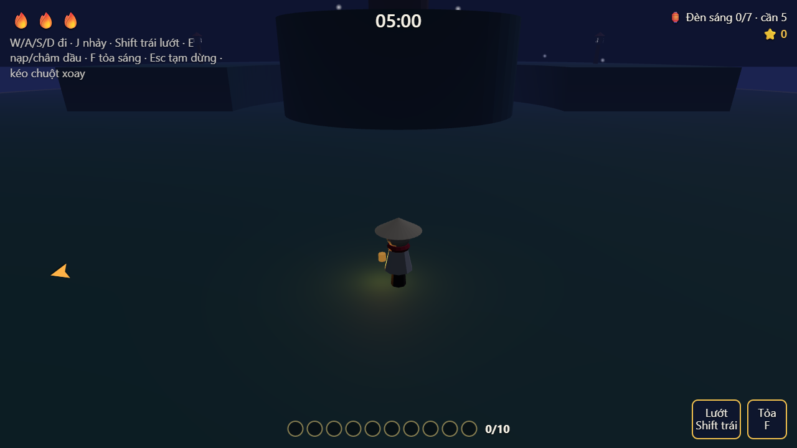

# Đảo Đèn Lồng

> 🎬 Video demo: *(chưa có: sẽ đính kèm vào GitHub Release v1.0.0 sau khi quay)*

Game 3D góc nhìn thứ ba. Mây, người giữ đèn nhỏ tuổi đội nón lá, gom đom đóm để thắp và **giữ cho Đèn Lồng Lớn còn dầu tới bình minh** trên **ba hòn đảo trong ba đêm**, né Bóng Mực và Gió Lạc trong sương đen. Có bảng xếp hạng cục bộ, đổi phím, phụ đề, giảm chuyển động và chữ lớn.



## Yêu cầu hệ thống

- **Node.js ≥ 22.18** (khuyên dùng 24). Server game chạy thẳng `src/leaderboard.ts` nhờ tính năng tự bỏ kiểu TypeScript có sẵn trong Node.
- Trình duyệt có **WebGL2**: Edge, Chrome, Firefox hoặc Safari bản mới.
- Chạy được trên macOS, Linux và Windows. Lệnh bench cần thêm Edge hoặc Chrome đã cài (xem mục Bench).

## Cài đặt và chơi (3 lệnh)

```bash
git clone https://github.com/mihtan05/K5-L3A-DAY12-DuongMinhTan-2A202603464-AI-SDLC-Dao-Den-Long.git && cd K5-L3A-DAY12-DuongMinhTan-2A202603464-AI-SDLC-Dao-Den-Long
npm ci
npm start
```

`npm start` build game vào `dist/`, chạy server ở http://localhost:4180 và tự mở trình duyệt. Bảng xếp hạng được lưu vào `data/leaderboard.json`.

Cách khác:
- `npm run dev`: chế độ phát triển (Vite), cũng lưu bảng xếp hạng vào `data/`.
- **Release v1.0.0**: tải file zip, giải nén, rồi chạy `node scripts/server.mjs`. Bản này không cần `npm`.

## Điều khiển (đổi được trong Cài đặt → Đổi phím)

| Phím mặc định | Hành động |
|---|---|
| W A S D | Đi (theo hướng camera) |
| Space | Nhảy |
| Shift trái | Lướt (14 m/s trong 0.2 s, hồi 1.5 s) |
| E | Tương tác: nạp đom đóm vào đèn tắt, hoặc châm dầu cho đèn đang sáng |
| F | Tỏa sáng: xua Bóng Mực và Gió Lạc (tốn 3 đom đóm) |
| Esc | Tạm dừng (Tiếp tục / Chơi lại Đêm / Cài đặt / Về menu) |
| Kéo chuột / ← → | Xoay camera (chỉnh độ nhạy trong Cài đặt) |

**Cài đặt** (được lưu lại):
- âm lượng và độ nhạy chuột;
- **Đổi phím** cho cả 9 hành động. Game báo khi phím đã được dùng cho hành động khác, và có nút "Khôi phục mặc định";
- **Bảng màu dễ phân biệt** cho người mù màu;
- **Phụ đề và chỉ báo hình ảnh**: báo khi Bóng Mực xuất hiện (kèm mũi tên ở mép màn hình), gió sắp thổi, còn 10 giây cuối, và đèn còn dưới 30 dầu;
- **Giảm chuyển động**: tắt rung camera và chớp màn hình;
- **Chữ lớn ×1.25**. Ở cỡ thường, mọi chữ đều ≥ 18 px ở độ phân giải 1280×720.

## Luật và cách tính điểm

- **3 Đêm:**
  - Đảo Bến: 5 đèn, 4:00.
  - Đảo Cau: 6 đèn, 4:30. Hai đảo nối bằng cầu tre và bục nhảy.
  - Đảo Chuông: 7 đèn, 5:00. Ba tầng, có dốc, bục nhảy và gió mạnh.

  Thua thì chơi lại Đêm đó. Thắng Đêm 3 thì tới màn Bình Minh.
- **Mục tiêu:** giữ đảo sáng tới bình minh. Hết giờ mà Mây còn lửa và số đèn **đang sáng** ≥ 60% (3/5, 4/6, 5/7) thì thắng.
- **Đom đóm:** tự nhặt khi đi qua. Sức chứa 10, mỗi lần thắp thành công +2 (tối đa 20).
- **Đèn:**
  - Đèn chưa sáng: nạp 10 đom đóm để thắp lần đầu, 5 đom đóm để thắp lại.
  - Đèn đang sáng: châm dầu, mỗi đom đóm +10 dầu.
- **Dầu đèn:** từ 0 tới 100, cháy 1/giây; hết dầu thì đèn tắt. Dưới 30 dầu, đèn nhấp nháy, mất vùng an toàn và bị Bóng Mực hút dầu (5/giây mỗi con).
- **Bóng Mực:** chạy 4 m/s (Đêm 3: 4.5 m/s). Bị chạm thì:
  - mất 1 lửa;
  - rơi một nửa số đom đóm đang mang;
  - được bất tử 1.5 s.
- **Tỏa sáng:**
  - làm Bóng Mực trong 5 m bị choáng 2 s và đẩy chúng lùi 4 m;
  - hồi chiêu 3 s.
- **Rơi khỏi đảo:** mất 1 lửa và mất hết đom đóm.
- **Gió Lạc** (Đêm 2, 3): cướp 3 đom đóm.
- **Bùa Gió:** trong 10 s, Mây chạy 7.2 m/s và lướt không cần hồi chiêu.

| Sự kiện | Điểm |
|---|---|
| Mỗi đom đóm nạp vào đèn (thắp, thắp lại, châm dầu) | +5 |
| Thắp lần đầu / thắp lại | +100 / +40 |
| Mỗi Bóng Mực trúng Tỏa sáng | +5 (+15 nếu nó đang hút dầu) |
| Bình minh (chỉ khi thắng): mỗi đèn đang sáng | +50 + phần nguyên của dầu |
| Bình minh (chỉ khi thắng): mỗi ngọn lửa còn lại | +50 |

Tổng điểm là tổng điểm các Đêm đã thắng.

**Bảng xếp hạng:**
- Sau màn Bình Minh hoặc sau khi thua, người chơi nhập tên để lưu điểm.
- Tên dài 3–12 ký tự, gồm chữ (có dấu cũng được), số hoặc `_`.
- Bảng giữ 10 người cao điểm nhất. Bằng điểm thì ai đạt trước đứng trên.
- Xem bảng ở menu chính, mục "Bảng xếp hạng".

## Kiểm thử, headless, bench, soak (Test Contract v1.3)

Mọi lệnh được khai báo trong [game.contract.json](game.contract.json).

```bash
npm test                                     # unit test (Vitest)
npm run typecheck
npx tsx src/headless/cli.ts --seed 1 --night 1 --ticks 600 --out out/run.jsonl [--scenario f.json] [--inputs f.json]
npm run soak -- --seed 7 --nights 10 --out soak.json
npm run bench -- --seed 42 --duration 30 --out bench.json
npm start -- --export-leaderboard out.json   # {"entries": [...]} theo thứ tự bảng
npm run verify -- phase-4                    # unit test + mọi scenario chạy 2 lần (tất định) + so kết quả mong đợi + lưu bằng chứng
npm run build && npm run smoke -- phase-4    # kiểm tra trong trình duyệt thật + chụp ảnh
```

**Soak:**
- Chạy 10 Đêm liên tiếp trong một tiến trình, xoay vòng Đêm 1 → 2 → 3.
- Đêm thứ i (đếm từ 1) dùng seed 7 + i.
- Input ngẫu nhiên theo seed: đổi hướng mỗi 30 tick; mỗi tick có 5% nhảy, 3% lướt, 2% tỏa sáng và 10% tương tác.

**Bench:**
- Build game, mở cửa sổ trình duyệt với khung vẽ 1280×720 và **tắt vsync** (`--disable-gpu-vsync --disable-frame-rate-limit`).
- Cảnh đo: Đêm 1 có 200 Bóng Mực, 100 đom đóm và đèn L1–L3 đang sáng. Camera bay vòng bán kính 30 m, cao 15 m, 15 s một vòng.
- Khởi động 3 s, đo `--duration` s, rồi ghi file JSON.
- Trình duyệt: Edge trên Windows, Chrome trên macOS/Linux; không có thì dùng Chromium của Playwright (`npx playwright install chromium`). Muốn chọn khác thì đặt biến `BROWSER_CHANNEL`.
- `peak_mem_mb` là `null`: trang web không đọc được RSS của tiến trình trình duyệt. File có thêm `js_heap_peak_mb` để tham khảo.

**Kết quả trên máy của tôi:** [bench.json](bench.json), [soak.json](soak.json), bằng chứng ở [docs/proof/phase-4](docs/proof/phase-4/README.md).

## Tài liệu
- Kế hoạch: [KE_HOACH.md](KE_HOACH.md) · Hướng dẫn agent: [AGENTS.md](AGENTS.md) · Thay đổi theo phase: [CHANGELOG.md](CHANGELOG.md)
- Thiết kế: [ADR 0001](docs/adr/0001-lantern-fuel-and-dawn-win.md) · Giả định: [docs/notes/assumptions.md](docs/notes/assumptions.md) · Thay đổi: [docs/notes/changes.md](docs/notes/changes.md)
- Nhật ký AI: [docs/notes/ai-log.md](docs/notes/ai-log.md) · Retro: [docs/notes/retro.md](docs/notes/retro.md)
- Bằng chứng: [Phase 1](docs/proof/phase-1/README.md) · [Phase 2](docs/proof/phase-2/README.md) · [Phase 3](docs/proof/phase-3/README.md) · [Phase 4](docs/proof/phase-4/README.md)
- Đề bài lab: [docs/lab/](docs/lab/README.md) · Ticket: [02](docs/lab/TICKET-02.md), [03](docs/lab/TICKET-03.md), [04](docs/lab/TICKET-04.md)
- Nguồn asset: [CREDITS.md](CREDITS.md) · Giấy phép: [LICENSE](LICENSE)

## Sáng tạo của tôi

- **Mây đội nón lá**, mặc áo bà ba, quàng khăn hổ phách, cầm đèn lồng giấy. Đèn tay sáng dần theo số đom đóm đang mang.
- **Âm thanh tự tổng hợp** bằng Web Audio theo gam ngũ cung. Nhặt đom đóm liên tiếp thì nốt nhạc lên cao dần.
- **Đảo sáng dần**: ánh sáng môi trường tăng theo số đèn đang sáng.
- **Mũi tên mục tiêu** (sau v1.0.0): tay không thì chỉ tới đom đóm, đang cầm thì ưu tiên đèn sắp cạn dầu, kèm khoảng cách. Dùng cả biểu tượng lẫn màu nên vẫn rõ ở bảng màu dễ phân biệt.
- **Lời Ông Đăng** cho từng Đêm, lá bay báo trước cơn gió, nhạc nền đêm tự tổng hợp.

Tất cả nằm ở phần hiển thị (`src/render/`), headless không dùng tới chúng. `npm run verify` vẫn PASS, xem [docs/proof/phase-4/verify-summary.txt](docs/proof/phase-4/verify-summary.txt).
